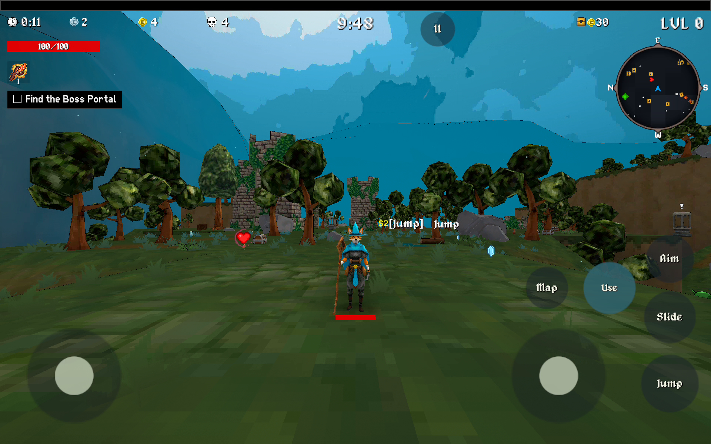
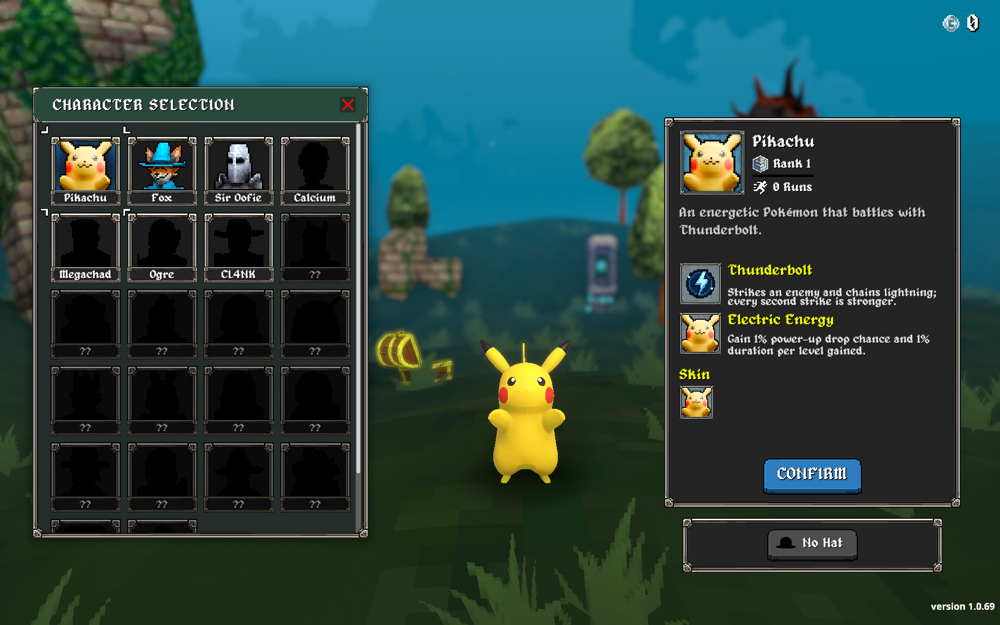

# OpenBonk

[](https://github.com/martin2844/OpenBonk/releases)
[](https://github.com/martin2844/OpenBonk/releases)
[](#start-playing)
[](docs/MODDING.md)
[](https://buymeacoffee.com/martin2844)

**Play Megabonk on Android with a native launcher, controller or touch input, and experimental Lua mods.**

OpenBonk is an unofficial community project in beta. Bring your own compatible Steam copy of Megabonk: the launcher prepares its data on your Android device.

[Download the beta](https://github.com/martin2844/OpenBonk/releases) · [Installation guides](#installation-guides) · [Install with an AI agent](#install-with-an-ai-agent) · [Lua modding](docs/MODDING.md) · [Build from source](docs/BUILD_QUICKSTART.md) · [Report a problem](https://github.com/martin2844/OpenBonk/issues) · [Support](#support-the-project)

## Support the project

If you enjoy OpenBonk and would like to support its development, you can [buy Martin a coffee](https://buymeacoffee.com/martin2844).


## Start playing

1. Download `OpenBonk.apk` from the newest [beta release](https://github.com/martin2844/OpenBonk/releases). The ZIP helpers referenced in the guides are available in the [0.1.2 beta package](https://github.com/martin2844/OpenBonk/releases/tag/v0.1.2-beta); use the APK from the newest release.
2. Create a ZIP containing the `Megabonk_Data` folder from your own compatible Steam installation. The ZIP must be no larger than **1 GiB**; the guide explains how to create a smaller ZIP if necessary.
3. Copy `OpenBonk.apk` and your private game-data ZIP to Android. Install and open the APK, choose **Megabonk game files ZIP**, and wait for **Data ready**.
4. Choose **Touch** or **Controller**, then press **Play**. The first launch also imports text and textures.

OpenBonk requires **64-bit Android 8 or later**. It has been tested on a Retroid Pocket 5, an iPlay 70 mini Pro and a Xiaomi phone. Device compatibility is still being established. Back up existing progress before replacing or uninstalling an app.

Install newer official APKs over your existing app to keep your profile. A ZIP saved with **Export profile** can also be restored with **Import profile ZIP** on a newer release. Keep a pre-update export if you plan to return to an older build.



## Installation guides

Choose a guide for detailed instructions on Steam data, installation, progress backups and troubleshooting. The guides may link to an older helper ZIP: install the APK from the newest release above. Translations other than English and Spanish are machine-generated from the English guide; please report unclear instructions.

| | | |
| --- | --- | --- |
| [English](docs/install/en.md) | [Español](docs/install/es.md) | [Español (Latinoamérica)](BETA_TESTER_GUIDE.md) |
| [Čeština](docs/install/cs.md) | [Deutsch](docs/install/de.md) | [Français](docs/install/fr.md) |
| [Italiano](docs/install/it.md) | [日本語](docs/install/ja.md) | [한국어](docs/install/ko.md) |
| [Polski](docs/install/pl.md) | [Português](docs/install/pt.md) | [Русский](docs/install/ru.md) |
| [ไทย](docs/install/th.md) | [Türkçe](docs/install/tr.md) | [Українська](docs/install/uk.md) |
| [简体中文](docs/install/zh-Hans.md) | [繁體中文](docs/install/zh-Hant.md) | |

## Install with an AI agent

Have a coding agent on your computer? Connect your Android device by USB and paste the prompt below into your agent. USB debugging is optional: the agent can guide you through enabling it, or help you install using file transfer without it. What it can automate depends on your computer, device and agent permissions.

```text
Help me install and launch OpenBonk on my Android device. Work through the
steps with me and do whatever you can directly on this computer.

Read https://github.com/martin2844/OpenBonk and the installation guide for my
language. Detect my operating system, find my own compatible Megabonk Steam
installation and download the official beta package linked by the project.
Use the guide to create the game-data ZIP, including the size-limited helper
if needed. Keep my game files, ZIPs, profile and account details private;
do not upload or share them.

Check for a connected Android device. If ADB is available and my device has
authorized USB debugging, use it where appropriate to transfer the APK and
ZIP and install or launch the app. If authorization is pending, explain the
on-device prompt. Do not assume debugging is enabled or try to bypass it.

If debugging is off, offer me a choice: guide me through enabling Developer
options and USB debugging on my Android device and authorizing this computer,
or continue without debugging. Explain that the settings can vary by device.
If ADB is missing, help me install Android platform tools if I choose that route.

Without debugging, use USB file transfer (MTP) if accessible and walk me through
unlocking the device, selecting File transfer, copying the files if necessary,
installing the APK and approving Android's prompts. If USB transfer is
unavailable, suggest a local transfer method and guide me.

Help me choose touch or controller, import the Steam ZIP in the launcher, wait
for Data ready and start the game. Ask me to perform any step that requires
interaction on the device. Preserve existing installations and saves: help me
back up progress before any replacement or uninstall, and ask before removing
anything. If a step fails, explain what happened and help me troubleshoot.
```

## Touch controls

The beta includes an in-game layout editor with individual visibility and opacity, grid snapping, saved profiles and optional auto-run. Tap **Edit** at the bottom of the game screen to open it, then tap **Done** to return to play. See the [touch controls guide](docs/TOUCH_CONTROLS.md).

## Mods

Import mod ZIPs from the launcher with **Import mod**, then enable them under **Manage mods**. New imports and updates start disabled. The [Lua modding guide](docs/MODDING.md) covers the package format and a first mod; [`mods/`](mods/) contains examples, including the experimental [Pikachu mod](mods/pikachu/README.md).



The Lua interface is under development. It offers specific stat hooks and experimental content callbacks; it does not yet expose every game system or provide automatic compatibility with other recomp projects. Install mods from sources you trust: the current sandbox is not a security boundary.

## Source and development

The repository contains reconstructed C# game scripts, the Android launcher and import code, a native Lua bridge, shaders and development tools. The code is a reconstruction, not a byte-for-byte decompilation.

- [Local build quickstart](docs/BUILD_QUICKSTART.md) — create a private research APK using compatible local game files and the required tools.
- [Build status and limitations](docs/BUILDING.md) — dependencies, verification results and known gaps.
- [Unity source](unity/OpenBonk/Assets/) · [Lua runtime](native/lua/) · [Mod examples](mods/) · [Preparation tools](tools/)

Building Android requires a compatible local Steam installation, Unity with Android support, AssetRipper and other dependencies; generated game data and signing keys are not included. A fresh clone has produced a playable Android build, but the exact published APK has not yet been independently rebuilt from scratch. See [Android build instructions](docs/BUILDING.md).

## Privacy and attribution

Keep your Steam game-data ZIP, profile, signing keys and account information private. The launcher requests Internet access to check the OpenBonk update manifest and mod catalog on GitHub, and downloads only what you choose to install. It checks for updates periodically; Android asks for confirmation before installing an APK. Steam game data and profiles are not uploaded. Android system backup may include app data depending on device settings. A Feedback button opens GitHub Issues in your browser; it does not send a report automatically.

OpenBonk is not affiliated with or endorsed by Megabonk or its developer. Game-derived code, shaders, assets and third-party components have differing provenance; distribution rights and a complete license inventory have not yet been established. Pokémon and Pikachu belong to their respective rights holders. See the [Pikachu notes](mods/pikachu/README.md) for model attribution and provenance.
