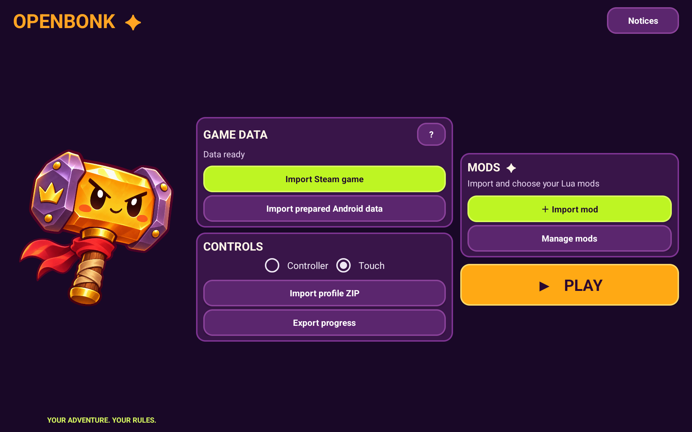
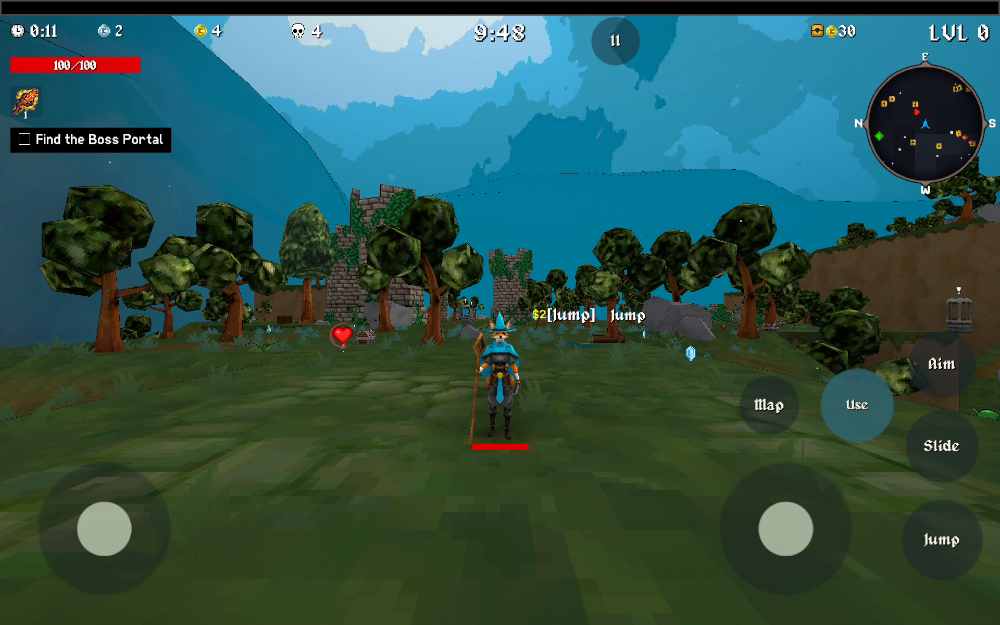
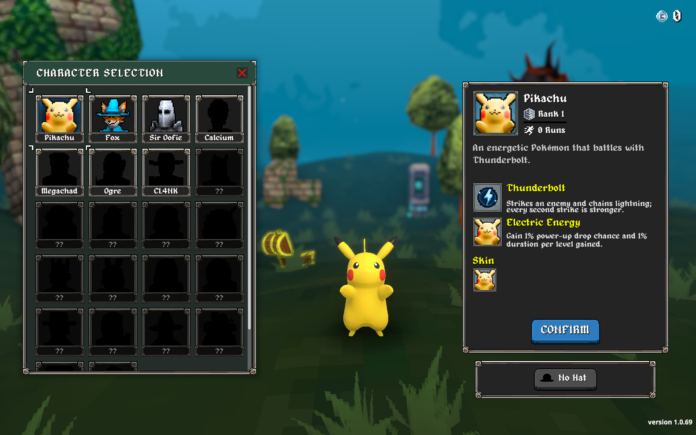

# OpenBonk

**An unofficial native Android port of Megabonk, with a launcher and experimental Lua mods.** Bring your own compatible Steam copy; the launcher prepares its game data on your device.

[Download the Android beta](https://github.com/martin2844/OpenBonk/releases/tag/v0.1.0-beta) · [Installation guide (Español)](BETA_TESTER_GUIDE.md) · [Lua modding](docs/MODDING.md) · [Source and build status](docs/BUILDING.md)

*The Android launcher imports your game data and mod ZIPs, manages mods, and lets you select touch or controller input.*

## Get started

1. Download **OpenBonk-beta.zip** from the [beta release](https://github.com/martin2844/OpenBonk/releases/tag/v0.1.0-beta) and extract it on your computer.
2. In Steam, open Megabonk's installed files and create a ZIP containing the `Megabonk_Data` folder. The [installation guide](BETA_TESTER_GUIDE.md) has Windows and Linux instructions, a 1 GiB limit and an optional smaller-ZIP helper.
3. Copy both `OpenBonk.apk` and your game-data ZIP to your Android device. Install the APK, open OpenBonk and choose **Import Steam game**. Wait for **Data ready**.
4. Choose **Touch** or **Controller**, then press **Play**. The first launch also imports text and textures.

OpenBonk requires 64-bit Android 8 or newer and a supported version of the game. It has been tested on Retroid Pocket 5 and iPlay 70 mini Pro. This is a beta: installation from Windows on a physical Windows PC and installation through the Android system installer have not yet been verified end to end. Back up existing progress before replacing or uninstalling an app.

## Mods

From the launcher, choose **Import mod**, select a compatible mod ZIP, and enable it under **Manage mods**. Imports and updates start disabled. The [modding guide](docs/MODDING.md) explains the package format and provides a first Lua mod. See [`mods/`](mods/) for examples, including the experimental [Pikachu mod](mods/pikachu/README.md).

The Lua interface is in development: it has specific stat hooks and experimental content callbacks, not unrestricted access to every game system or automatic compatibility with other recomp projects. Install mods from sources you trust; the current sandbox is not a security boundary.

## Source and contribution

This repository includes the reconstructed C# game scripts, Android launcher and import code, native Lua bridge, and development tools. The current checkout **cannot yet reproduce the release APK on its own**: parts of the Unity project, third-party dependencies, generated plans, and game-derived data are not included. See [BUILDING.md](docs/BUILDING.md) for the layout and limitations. The code is a reconstruction, not a byte-for-byte decompilation.

## Privacy and project status

The APK does not request Android's Internet permission, although Android's system backup may include app data according to device settings. Do not attach your Steam game-data ZIP, profile, signing keys, or account information to a report. Back up your progress before changing installations.

OpenBonk is an unofficial community project and is not affiliated with or endorsed by Megabonk or its developer. Game-derived code, shaders, assets and third-party components have differing provenance; distribution rights and a complete license inventory have not yet been established. Pokémon and Pikachu belong to their respective rights holders. See the [Pikachu notes](mods/pikachu/README.md) for model attribution and provenance.
