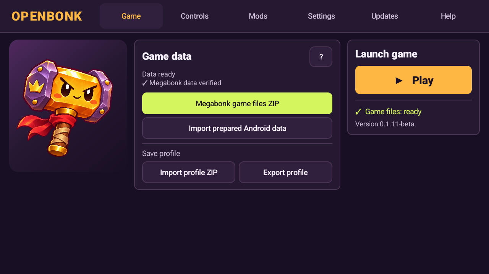

# OpenBonk

**Play Megabonk on Android with a native launcher, controller or touch input, and experimental Lua mods.**

OpenBonk is an unofficial community project in beta. Bring your own compatible Steam copy of Megabonk: the launcher prepares its data on your Android device.

[Download the beta](https://github.com/martin2844/OpenBonk/releases/tag/v0.1.0-beta) · [Installation guides](#installation-guides) · [Lua modding](docs/MODDING.md) · [Build from source](docs/BUILD_QUICKSTART.md) · [Report a problem](https://github.com/martin2844/OpenBonk/issues)

## Start playing

1. Download `OpenBonk-beta.zip` from the [beta release](https://github.com/martin2844/OpenBonk/releases/tag/v0.1.0-beta) and extract it on your computer.
2. Create a ZIP containing the `Megabonk_Data` folder from your own compatible Steam installation. The ZIP must be no larger than **1 GiB**; the guide explains how to create a smaller ZIP if necessary.
3. Copy `OpenBonk.apk` and your private game-data ZIP to Android. Install and open the APK, choose **Import Steam game**, and wait for **Data ready**.
4. Choose **Touch** or **Controller**, then press **Play**. The first launch also imports text and textures.

OpenBonk requires **64-bit Android 8 or later**. It has been tested on a Retroid Pocket 5 and an iPlay 70 mini Pro. Device compatibility is still being established, and installation from a physical Windows PC and through the Android system installer have not been verified end to end. Back up existing progress before replacing or uninstalling an app.

## Installation guides

Choose a guide for detailed instructions on Steam data, installation, progress backups and troubleshooting. Translations other than English and Spanish are machine-generated from the English guide; please report unclear instructions.

| | | |
| --- | --- | --- |
| [English](docs/install/en.md) | [Español](docs/install/es.md) | [Español (Latinoamérica)](BETA_TESTER_GUIDE.md) |
| [Čeština](docs/install/cs.md) | [Deutsch](docs/install/de.md) | [Français](docs/install/fr.md) |
| [Italiano](docs/install/it.md) | [日本語](docs/install/ja.md) | [한국어](docs/install/ko.md) |
| [Polski](docs/install/pl.md) | [Português](docs/install/pt.md) | [Русский](docs/install/ru.md) |
| [ไทย](docs/install/th.md) | [Türkçe](docs/install/tr.md) | [Українська](docs/install/uk.md) |
| [简体中文](docs/install/zh-Hans.md) | [繁體中文](docs/install/zh-Hant.md) | |

## Mods

Import mod ZIPs from the launcher with **Import mod**, then enable them under **Manage mods**. New imports and updates start disabled. The [Lua modding guide](docs/MODDING.md) covers the package format and a first mod; [`mods/`](mods/) contains examples, including the experimental [Pikachu mod](mods/pikachu/README.md).

The Lua interface is under development. It offers specific stat hooks and experimental content callbacks; it does not yet expose every game system or provide automatic compatibility with other recomp projects. Install mods from sources you trust: the current sandbox is not a security boundary.

## Source and development

The repository contains reconstructed C# game scripts, the Android launcher and import code, a native Lua bridge, shaders and development tools. The code is a reconstruction, not a byte-for-byte decompilation.

- [Local build quickstart](docs/BUILD_QUICKSTART.md) — create a private research APK using compatible local game files and the required tools.
- [Build status and limitations](docs/BUILDING.md) — dependencies, verification results and known gaps.
- [Unity source](unity/OpenBonk/Assets/) · [Lua runtime](native/lua/) · [Mod examples](mods/) · [Preparation tools](tools/)

The checkout cannot yet reproduce the published APK on its own: parts of the Unity project, third-party dependencies, generated plans and game-derived data are not included. The local research APK is not a redistributable release.

## Privacy and attribution

Keep your Steam game-data ZIP, profile, signing keys and account information private. The APK does not request Android's Internet permission, but Android system backup may include app data depending on device settings.

OpenBonk is not affiliated with or endorsed by Megabonk or its developer. Game-derived code, shaders, assets and third-party components have differing provenance; distribution rights and a complete license inventory have not yet been established. Pokémon and Pikachu belong to their respective rights holders. See the [Pikachu notes](mods/pikachu/README.md) for model attribution and provenance.
